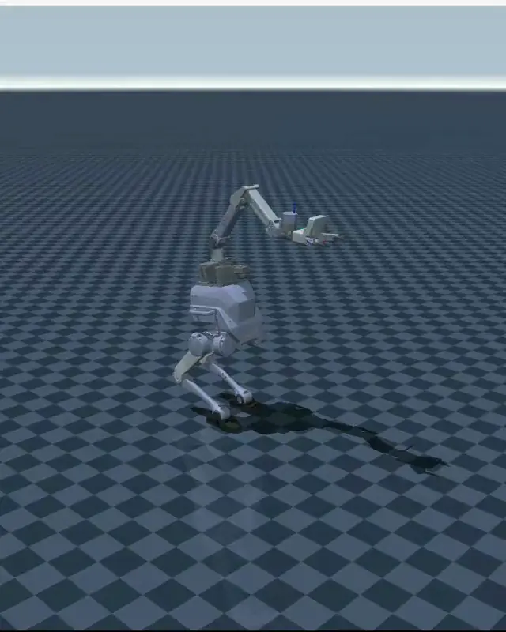
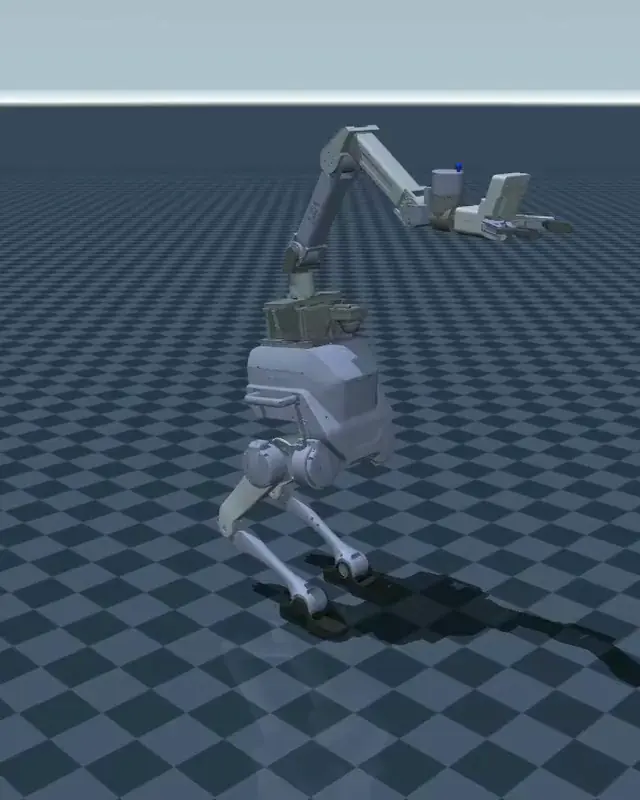
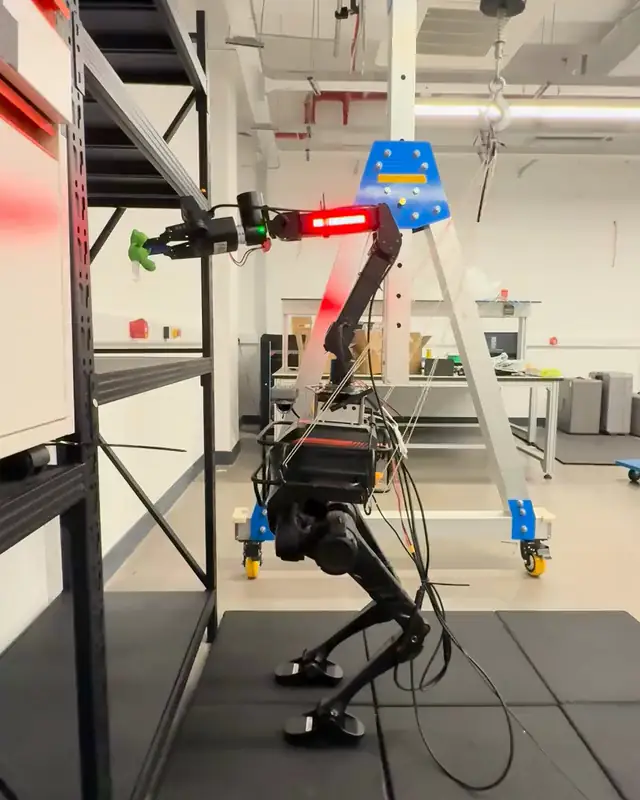
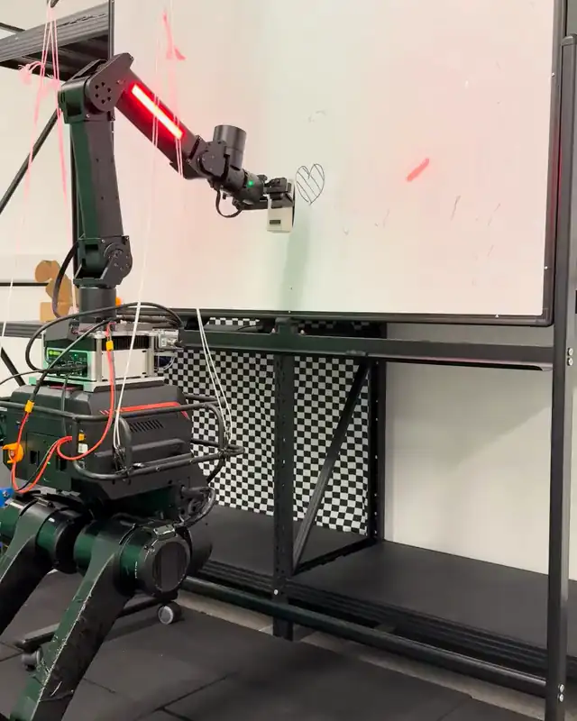

  <section class="blog-home-hero" aria-labelledby="blog-home-title">
    

      <h1 id="blog-home-title">Notes from the lab, and the work between.</h1>
      
Chen Jing (经宸) · Working notebook

      
I’m Chen Jing. This notebook follows my work in robotics: coordinate transforms, simulation checks, reward tuning—and the tools I use along the way.

    

    <!-- BLOG_HOME_COLLECTIONS -->
  </section>

  <section class="blog-home-lab" aria-labelledby="projects-ideas">
    

      <h2 class="section-title" id="projects-ideas">Projects &amp; Ideas</h2>
      
BipedalWBC, a project I contributed to: one learned controller turns a single 6-DoF end-effector target into coordinated arm and leg motion on a bipedal manipulator.

    

    <figure class="project-figure" data-project-figure="bipedalwbc" aria-labelledby="bwbc-figure-title" aria-describedby="bwbc-figure-caption">
      
<h3 id="bwbc-figure-title">BipedalWBC framework</h3><a href="https://wholebodyrobotics.github.io/BipedalWBC/" target="_blank" rel="noopener">Project page ↗</a><a href="https://arxiv.org/abs/2609.18930" target="_blank" rel="noopener">arXiv ↗</a>

      <!-- PROJECT_FIGURE:bipedalwbc -->
      <figcaption id="bwbc-figure-caption">Adapted from Fig. 2 of Chen, Nai et al., <cite>Learning Holistic Whole-Body Loco-Manipulation with a Bipedal Mobile Manipulator</cite> (2026); Chen Jing is a co-author.</figcaption>
    </figure>
    <section class="blog-home-clips" aria-labelledby="home-clips-title" data-home-clips>
      
<h3 id="home-clips-title">In motion</h3>
Simulation and lab footage · muted loops
<button type="button" class="edwinos-glass" data-home-clips-toggle aria-pressed="false" hidden>Pause clips</button>

      <ul class="blog-home-clips__grid">
      <li><figure class="home-clip" data-home-clip data-src="assets/media/home-clip-z-workspace.mp4" data-focus="0.5,0.5" style="--ground:var(--home-clip-ground-1)" tabindex="0" aria-label="Z workspace, simulation, original speed. Press space or enter to pause or play.">
        
<canvas aria-hidden="true"></canvas><video muted loop playsinline preload="none" aria-hidden="true" tabindex="-1"></video>

        <figcaption class="home-clip__chip">Z workspaceSimulation · original speed</figcaption>
        <button class="home-clip__play" type="button" data-home-clip-play aria-label="Play Z workspace">Play clip</button><noscript><a class="home-clip__download" href="assets/media/home-clip-z-workspace.mp4">Open video</a></noscript></figure></li>
      <li><figure class="home-clip" data-home-clip data-src="assets/media/home-clip-orientation.mp4" data-focus="0.5,0.5" style="--ground:var(--home-clip-ground-2)" tabindex="0" aria-label="Orientation, simulation, original speed. Press space or enter to pause or play.">
        
<canvas aria-hidden="true"></canvas><video muted loop playsinline preload="none" aria-hidden="true" tabindex="-1"></video>

        <figcaption class="home-clip__chip">OrientationSimulation · original speed</figcaption>
        <button class="home-clip__play" type="button" data-home-clip-play aria-label="Play Orientation">Play clip</button><noscript><a class="home-clip__download" href="assets/media/home-clip-orientation.mp4">Open video</a></noscript></figure></li>
      <li><figure class="home-clip" data-home-clip data-src="assets/media/home-clip-lower.mp4" data-focus="0.5,0.5" style="--ground:var(--home-clip-ground-3)" tabindex="0" aria-label="Lower placement, lab footage, original speed. Press space or enter to pause or play.">
        
<canvas aria-hidden="true"></canvas><video muted loop playsinline preload="none" aria-hidden="true" tabindex="-1"></video>

        <figcaption class="home-clip__chip">Lower placementLab footage · original speed</figcaption>
        <button class="home-clip__play" type="button" data-home-clip-play aria-label="Play Lower placement">Play clip</button><noscript><a class="home-clip__download" href="assets/media/home-clip-lower.mp4">Open video</a></noscript></figure></li>
      <li><figure class="home-clip" data-home-clip data-src="assets/media/home-clip-board.mp4" data-focus="0.5,0.5" style="--ground:var(--home-clip-ground-4)" tabindex="0" aria-label="Board wiping, lab footage, original speed. Press space or enter to pause or play.">
        
<canvas aria-hidden="true"></canvas><video muted loop playsinline preload="none" aria-hidden="true" tabindex="-1"></video>

        <figcaption class="home-clip__chip">Board wipingLab footage · original speed</figcaption>
        <button class="home-clip__play" type="button" data-home-clip-play aria-label="Play Board wiping">Play clip</button><noscript><a class="home-clip__download" href="assets/media/home-clip-board.mp4">Open video</a></noscript></figure></li>
      </ul>
    </section>
  </section>

  <section class="blog-home-section" aria-labelledby="recent-updates">
    

      <h2 class="section-title" id="recent-updates">Recent Updates</h2>
      <a class="edwinos-glass blog-home-archive" href="HOME/Archive/">View archive</a>
    

    <!-- BLOG_HOME_UPDATES -->
  </section>

  <section class="blog-home-section" aria-labelledby="start-here">
    

      <h2 class="section-title" id="start-here">Start Here</h2>

    

    

      <a class="blog-home-card edwinos-glass" href="OsdNotes/Embodied%20AI/%E3%80%90Hand-Eye%20Calibration%E3%80%91%20%E6%89%8B%E7%9C%BC%E6%A0%87%E5%AE%9A%E7%90%86%E8%AE%BA%E4%B8%8E%E5%AE%9E%E8%B7%B5/">
        
<svg class="research-figure__edges"></svg>Robot poses → Relative motion → Estimate

        <h3>Connecting camera and robot</h3>
        
Follow the coordinate frames, solve AX = XB, and check what a calibration actually tells you.

      </a>
      <a class="blog-home-card edwinos-glass" href="%E7%BB%8F%E9%AA%8C%E5%88%86%E4%BA%AB/Phi%20Lab/WBC/Sim2Sim%E9%85%8D%E7%BD%AE%E4%B8%8E%E8%AE%AD%E7%BB%83/">
        <h3>From Isaac Lab to MuJoCo</h3>
        
ONNX exports, joint order, and deployment checks for a policy running in a second simulator.

      </a>
      <a class="blog-home-card edwinos-glass" href="OsdNotes/Github%E5%AD%A6%E4%B9%A0%E7%AC%94%E8%AE%B0/Git%20with%20gh/">
        <h3>Git, without losing the thread</h3>
        
Branches, forks, and pull requests: a reference for everyday collaboration.

      </a>
    

  </section>

<footer class="visitor-meta-footer" data-visitor-deployment data-deployment-repository="SPIRAL-EDWIN/edwinjing-blog-website" data-deployment-workflow="deploy.yml">
      

        
Content licensed under <a href="https://creativecommons.org/licenses/by-nc-sa/4.0/" target="_blank" rel="noopener">CC BY-NC-SA 4.0</a>

        

          &copy; Chen Jing
          &middot;
          <time class="visitor-meta-footer__updated" data-visitor-deployment-time datetime="2026-10">Latest updated Oct. 2026</time>
        

      

      

        
      

    </footer>

