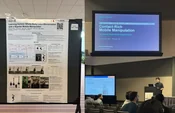

  <aside class="academic-sidebar">
    

      

        
      

      

      

        <h1 class="profile-name">Chen Jing (经宸)</h1>
        
Edwin · he/him

        
Undergraduate Student

      

      

        <a href="./HOME/Archive/" class="btn-github-action">Archive of Updates</a>
      

      

        <a href="./HOME/friends/" class="follower-link">
          <svg class="meta-icon" viewBox="0 0 16 16" width="16" height="16" aria-hidden="true"><path d="M2 5.5a3.5 3.5 0 1 1 5.898 2.549 5.508 5.508 0 0 1 3.034 4.084.75.75 0 1 1-1.482.235 4 4 0 0 0-7.9 0 .75.75 0 0 1-1.482-.236A5.507 5.507 0 0 1 3.102 8.05 3.493 3.493 0 0 1 2 5.5ZM11 4a3.001 3.001 0 0 1 2.22 5.018 5.01 5.01 0 0 1 2.56 3.012.749.749 0 0 1-.885.954.752.752 0 0 1-.549-.514 3.507 3.507 0 0 0-2.522-2.372.75.75 0 0 1-.574-.73v-.352a.75.75 0 0 1 .416-.68 1.5 1.5 0 0 0-.14-2.828.75.75 0 0 1-.714-.807l.006-.051A1.5 1.5 0 0 0 11 4Z"></path></svg>
          2 followers · followings
        </a>
      

      <ul class="profile-meta">
        <li>
          <svg class="meta-icon" viewBox="0 0 16 16" width="16" height="16" aria-hidden="true"><path d="M1.75 16A1.75 1.75 0 0 1 0 14.25V1.75C0 .784.784 0 1.75 0h8.5C11.216 0 12 .784 12 1.75v12.5c0 .085-.006.168-.018.25h2.268a.25.25 0 0 0 .25-.25V8.285a.25.25 0 0 0-.111-.208l-1.055-.703a.749.749 0 1 1 .832-1.248l1.055.703c.487.325.779.871.779 1.456v5.965A1.75 1.75 0 0 1 14.25 16ZM5.75 14.5h1.5v-2.75A.75.75 0 0 1 8 11h1.5a.75.75 0 0 1 .75.75v2.75h1.5a.25.25 0 0 0 .25-.25V1.75a.25.25 0 0 0-.25-.25h-8.5a.25.25 0 0 0-.25.25v12.5c0 .138.112.25.25.25Zm-.75-11a.75.75 0 0 1 .75-.75h.5a.75.75 0 0 1 0 1.5h-.5A.75.75 0 0 1 5 3.5Zm0 3a.75.75 0 0 1 .75-.75h.5a.75.75 0 0 1 0 1.5h-.5A.75.75 0 0 1 5 6.5Zm3-3a.75.75 0 0 1 .75-.75h.5a.75.75 0 0 1 0 1.5h-.5A.75.75 0 0 1 8 3.5Zm0 3a.75.75 0 0 1 .75-.75h.5a.75.75 0 0 1 0 1.5h-.5A.75.75 0 0 1 8 6.5Z"></path></svg>
          <a href="https://www.zju.edu.cn/" target="_blank" rel="noopener" class="meta-link">Zhejiang University</a>
        </li>
        <li>
          <svg class="meta-icon" viewBox="0 0 16 16" width="16" height="16" aria-hidden="true"><path d="M8 0a8 8 0 1 1 0 16A8 8 0 0 1 8 0ZM1.5 8a6.5 6.5 0 1 0 13 0 6.5 6.5 0 0 0-13 0Zm7-3.25v2.992l2.028.812a.75.75 0 0 1-.557 1.392l-2.5-1A.751.751 0 0 1 7 8.25v-3.5a.75.75 0 0 1 1.5 0Z"></path></svg>
          Loading...
        </li>
        <li>
          <svg class="meta-icon" viewBox="0 0 16 16" width="16" height="16" aria-hidden="true"><path d="M1.75 2h12.5c.966 0 1.75.784 1.75 1.75v8.5A1.75 1.75 0 0 1 14.25 14H1.75A1.75 1.75 0 0 1 0 12.25v-8.5C0 2.784.784 2 1.75 2ZM1.5 12.251c0 .138.112.25.25.25h12.5a.25.25 0 0 0 .25-.25V5.809L8.38 9.397a.75.75 0 0 1-.76 0L1.5 5.809v6.442Zm13-8.181v-.32a.25.25 0 0 0-.25-.25H1.75a.25.25 0 0 0-.25.25v.32L8 7.88Z"></path></svg>
          <a href="mailto:edwinjing2026@outlook.com" class="meta-link">edwinjing2026@outlook.com</a>
        </li>
      </ul>

      

        <a href="https://github.com/SPIRAL-EDWIN" target="_blank" rel="noopener" title="GitHub" aria-label="GitHub"><svg class="social-icon" aria-hidden="true" viewBox="0 0 16 16"><path d="M8 0C3.58 0 0 3.58 0 8c0 3.54 2.29 6.53 5.47 7.59.4.07.55-.17.55-.38 0-.19-.01-.82-.01-1.49-2.01.37-2.53-.49-2.69-.94-.09-.23-.48-.94-.82-1.13-.28-.15-.68-.52-.01-.53.63-.01 1.08.58 1.23.82.72 1.21 1.87.87 2.33.66.07-.52.28-.87.51-1.07-1.78-.2-3.64-.89-3.64-3.95 0-.87.31-1.59.82-2.15-.08-.2-.36-1.02.08-2.12 0 0 .67-.21 2.2.82A7.59 7.59 0 0 1 8 3.86c.68 0 1.36.09 2 .27 1.53-1.04 2.2-.82 2.2-.82.44 1.1.16 1.92.08 2.12.51.56.82 1.27.82 2.15 0 3.07-1.87 3.75-3.65 3.95.29.25.54.73.54 1.48 0 1.07-.01 1.93-.01 2.2 0 .21.15.46.55.38A8.013 8.013 0 0 0 16 8c0-4.42-3.58-8-8-8Z"></path></svg></a>
        <a href="https://www.linkedin.com/in/chen-jing-31a16a421/" target="_blank" rel="noopener" title="LinkedIn" aria-label="LinkedIn"><svg class="social-icon" aria-hidden="true" viewBox="0 0 448 512"><path d="M100.3 448H7.4V148.9h92.9V448ZM53.8 108.1C24.1 108.1 0 83.5 0 53.8A53.8 53.8 0 0 1 107.6 53.8c0 29.7-24.1 54.3-53.8 54.3ZM447.9 448h-92.7V302.4c0-34.7-.7-79.2-48.3-79.2-48.3 0-55.7 37.7-55.7 76.7V448h-92.8V148.9h89.1v40.8h1.3c12.4-23.5 42.7-48.3 87.9-48.3 94 0 111.3 61.9 111.3 142.3V448Z"></path></svg></a>
        <a href="https://scholar.google.com/citations?user=vgoqJdAAAAAJ&amp;hl=zh-CN" target="_blank" rel="noopener" title="Google Scholar" aria-label="Google Scholar"></a>
        <a href="https://www.youtube.com/@EdwinJing" target="_blank" rel="noopener" title="YouTube" aria-label="YouTube"><svg class="social-icon" aria-hidden="true" viewBox="0 0 576 512"><path d="M549.7 124.1c-6.2-23.7-24.8-42.3-48.3-48.6C458.9 64 288.1 64 288.1 64S117.3 64 74.7 75.5c-23.5 6.3-42 24.9-48.3 48.6C15 167 15 256.4 15 256.4s0 89.4 11.4 132.3c6.3 23.6 24.8 41.5 48.3 47.8C117.3 448 288.1 448 288.1 448s170.8 0 213.4-11.5c23.5-6.3 42-24.2 48.3-47.8 11.4-42.9 11.4-132.3 11.4-132.3s0-89.4-11.4-132.3zM232.2 337.6V175.2l142.7 81.2z"></path></svg></a>
        <a href="https://x.com/EdwinJing661" target="_blank" rel="noopener" title="Twitter/X" aria-label="Twitter/X"><svg class="social-icon" aria-hidden="true" viewBox="0 0 448 512"><path d="M357.2 48h70.6L273.6 224.2 455 464H313L201.7 318.6 74.5 464H3.8l164.9-188.5L-5.2 48h145.6l100.5 132.9zm-24.8 373.8h39.1L119.1 88h-42z"></path></svg></a>
      

      

    

  </aside>

  <main class="academic-content">
    <section class="academic-section animate-slide-up" style="--anim-delay: 0.1s;">
      <h2 class="section-title">About Me</h2>
      
Undergraduate researcher at <strong><a href="https://physicalintelligence-lab.github.io/" target="_blank" rel="noopener">Physical Intelligence Lab</a>, ZJU</strong>, advised by Prof. <a href="https://rvclab.github.io/author/liangjing-yang/" target="_blank" rel="noopener">Liangjing Yang</a> and previously by Prof. <a href="https://physicalintelligence-lab.github.io/author/hua-chen/" target="_blank" rel="noopener">Hua Chen</a>. Research on embodied AI, focusing on legged locomotion and whole-body loco-manipulation. Recipient of <strong>Gold Medal &amp; First Prize</strong> at the World Robot Contest Finals (WRCF) and <strong>Outstanding Student</strong> of Zhejiang University (2025–2026). Maintainer of <strong><a href="OsdNotes/">ENotes</a></strong>, an open notebook on whole-body control, real-robot deployment, and university course notes.

      

      
Detailed profile (详细个人介绍)

      

      
Hi! I am Chen Jing (经宸; Jing is my family name), a sophomore majoring in Mechanical Engineering at the <a href="https://zjui.intl.zju.edu.cn/" target="_blank" rel="noopener">ZJU-UIUC Institute (ZJUI)</a>, Zhejiang University. I am an undergraduate research assistant at the <a href="https://physicalintelligence-lab.github.io/" target="_blank" rel="noopener">Physical Intelligence Lab</a>, advised by Prof. <a href="https://rvclab.github.io/author/liangjing-yang/" target="_blank" rel="noopener">Liangjing Yang</a> and previously by Prof. <a href="https://physicalintelligence-lab.github.io/author/hua-chen/" target="_blank" rel="noopener">Hua Chen</a>.

      
My research focuses on embodied AI, especially legged locomotion and whole-body loco-manipulation. I am also eager to explore other directions that move robotics forward, such as vision-language-action (VLA) models and world models.

      
Recently, I contributed to <a href="https://arxiv.org/abs/2609.18930">a whole-body controller for a bipedal mobile manipulator</a> that tracks a single 6-DoF end-effector target, coordinating arm motion, posture adaptation, and stepping without explicit locomotion commands. My work covers:

      <ul style="--profile-reveal-order: 3;">
      <li><strong>Reward tuning</strong> for RL-based whole-body control in Isaac Lab</li>
      <li><strong>Sim2Sim validation</strong> of trained policies</li>
      <li><strong>Real-robot deployment</strong> on a LimX TRON 1 biped with an ARX L5 arm</li>
      </ul>
      
I have also worked with UMI-based diffusion policy pipelines.

      
I come from a robotics-competition and mechanical-design background (WRCF, VEX, ZJU Mechanical Design Competition), which keeps me grounded in how things work on real hardware. I am eager to bridge the gap between simulation and reality to enable robots with more agile and dexterous behaviors.

      

      

      
Hi！我是<strong>经宸 (English name: Chen Jing)</strong>，浙江大学–伊利诺伊大学厄巴纳-香槟校区联合学院（<a href="https://zjui.intl.zju.edu.cn/" target="_blank" rel="noopener">ZJUI</a>）机械工程专业大二学生。目前是 <a href="https://physicalintelligence-lab.github.io/" target="_blank" rel="noopener">Physical Intelligence Lab</a> 的本科生科研助理，师从 <a href="https://rvclab.github.io/author/liangjing-yang/" target="_blank" rel="noopener">Liangjing Yang</a> 教授，此前师从 <a href="https://physicalintelligence-lab.github.io/author/hua-chen/" target="_blank" rel="noopener">Hua Chen</a> 教授。

      
我的研究方向是具身智能，尤其关注足式运动与全身移动操作（loco-manipulation）。同时，我也乐于探索其他推动机器人发展的方向，例如视觉-语言-动作模型（VLA）与世界模型。

      
近期，我参与了<a href="https://arxiv.org/abs/2609.18930">一项双足移动操作机器人的全身控制器工作</a>：仅给定一个 6-DoF 末端执行器目标，控制器即可协调手臂运动、姿态调整与迈步，无需显式的运动指令。我主要负责：

      <ul style="--profile-reveal-order: 10;">
      <li>在 Isaac Lab 中为基于强化学习的全身控制进行<strong>奖励函数调参</strong></li>
      <li>对训练得到的策略进行 <strong>Sim2Sim 验证</strong></li>
      <li>在搭载 ARX L5 机械臂的 LimX TRON 1 双足机器人上进行<strong>真机部署</strong></li>
      </ul>
      
此外，我还接触过基于 UMI 的 diffusion policy 流程。

      
我有机器人竞赛与机械设计的背景（WRCF、VEX、浙江大学机械设计竞赛），这让我始终关注真实硬件上的实际表现。我希望弥合仿真与现实之间的差距，让机器人具备更敏捷、更灵巧的行为。

      

      

      

    </section>

    <section class="academic-section" data-overview-reveal="news">
      <h2 class="section-title">Recent News</h2>
      <!-- OVERVIEW_NEWS_AUTO -->
    </section>

    <section class="academic-section" data-overview-reveal="education">
      <h2 class="section-title">Education</h2>
      <ul class="overview-education-list">
        <li class="overview-education-item">
          

          

            
<a href="https://www.zju.edu.cn/" target="_blank" rel="noopener">Zhejiang University (ZJU)</a>

            
<a href="https://zjui.intl.zju.edu.cn/" target="_blank" rel="noopener">ZJU-UIUC Institute (ZJUI)</a>

            
B.Eng. in Mechanical Engineering

          

          

            
Sep. 2025 — Jul. 2029 (Expected)

            
Hangzhou

          

        </li>
      </ul>
    </section>

    <section class="academic-section" data-overview-reveal="experiences">
      <h2 class="section-title">Selected Experiences</h2>
      

        

          

            

              

                
                
              

              

                <h3 class="cv-title"><a href="https://physicalintelligence-lab.github.io/" target="_blank" rel="noopener noreferrer">Physical Intelligence Lab</a>, ZJU</h3>
                
Research Assistant — Whole-body control · Reinforcement learning · Reward tuning · Sim2Sim &amp; Sim2Real

              

              
Jun. 2026 — Present

            

          

        

      

    </section>

    <section class="academic-section" data-overview-reveal="publications">
      <h2 class="section-title">Publications</h2>
      <!-- OVERVIEW_PUBLICATIONS_AUTO -->
    </section>

    <section class="academic-section" data-overview-reveal="workshop">
      <h2 class="section-title">Workshop Contributions &amp; Presentations</h2>
      

        

          
        

        

          
<a href="https://mobile-manipulation.net/events/moma-iros26/" target="_blank" rel="noopener noreferrer">MoMA.v5 Workshop · IEEE/RSJ IROS 2026</a>

          <h3 class="overview-workshop__title">Learning Holistic Whole-Body Loco-Manipulation with a Bipedal Mobile Manipulator</h3>
          
Our short paper was accepted for a poster session and a 2-minute spotlight presentation.

          
Pittsburgh, USA · <time datetime="2026-09-27">September 27, 2026</time>

          <nav class="overview-workshop__links overview-publication__links" aria-label="Workshop related links">
            <a href="assets/posters/iros-2026-moma-poster.pdf" target="_blank" rel="noopener noreferrer">Poster</a>
            <a href="assets/posters/iros-2026-moma-spotlight-talk.pdf" target="_blank" rel="noopener noreferrer">Spotlight&thinsp;·&thinsp;Talk</a>
          </nav>
        

      

    </section>

    <section class="academic-section" data-overview-reveal="honors">
      <h2 class="section-title">Honors &amp; Awards</h2>
      <ul class="award-list">
        <li>10/2026<strong>Outstanding Student</strong> · Zhejiang University</li>
        <li>10/2026<strong>Pacesetter in Academic Excellence</strong> · Zhejiang University, CNY 10,000</li>
        <li>10/2026<strong>Pacesetter in International Exchange</strong> · Zhejiang University</li>
        <li>04/2026<strong>Third Prize</strong> · 31st Zhejiang University Mechanical Design Competition</li>
        <li>01/2024<strong>Gold Medal &amp; First Prize</strong> · World Robot Contest Finals (WRCF)</li>
        <li>08/2023<strong>Second Prize</strong> · National VEX Robotics Elite Competition (Hosted by SJTU)</li>
      </ul>
    </section>

    <footer class="visitor-meta-footer animate-slide-up" style="--anim-delay: 0.8s;" data-visitor-deployment data-deployment-repository="SPIRAL-EDWIN/edwinjing-blog-website" data-deployment-workflow="deploy.yml">
      

        
Content licensed under <a href="https://creativecommons.org/licenses/by-nc-sa/4.0/" target="_blank" rel="noopener">CC BY-NC-SA 4.0</a>

        

          &copy; Chen Jing
          &middot;
          <time class="visitor-meta-footer__updated" data-visitor-deployment-time datetime="2026-10">Latest updated Oct. 2026</time>
        

      

      

        
      

    </footer>
  </main>

